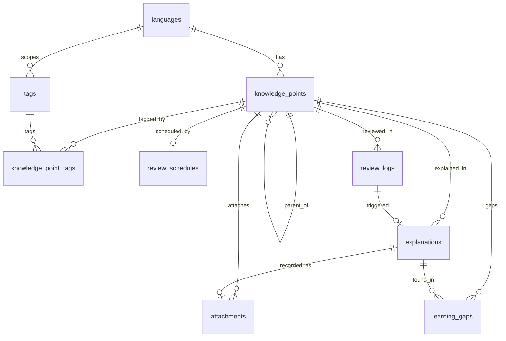

# Langly · SQLite 数据库设计建议稿

> **状态：设计建议稿 v0.2（三项决策已收口，其余未定稿）** — 本文档只做设计推荐，**尚未创建数据库、未写任何 Dart/SQL 落地代码、未修改项目其他文件**。
> 项目仍处于具体构想阶段，未决项见第 10 节。
>
> - 数据库（库名）：`langly`，实际落地为本地文件 `langly.db`
> - 技术假设：Flutter + `sqflite`（本地单机、离线优先），Flutter SDK ^3.14
> - 产品定位：记录语言知识点 → 用费曼学习法讲清楚 → 按间隔重复温故 → 在复习中产生新理解
> - 文档版本：**v0.2 · 2026-11-09**（v0.1 同日建立）

### 本版已确认的决策

| 决策 | 结论 | 对表结构的影响 |
| --- | --- | --- |
| 语言范围 | **多语言** | `languages` 保留在 P0；新增 `knowledge_points.gloss_lang`（释义语言）、`explanations.lang_code`（讲解语言）、`attachments.transcript_lang`（识别语言）三个语言标识 |
| 复习算法 | **SM-2** | `review_schedules.algorithm = 'sm2'` 锁定；四档 `result` → q 映射与完整公式见 5.6；`review_logs.quality` 改为必填派生列 |
| 讲解形态 | **支持语音** | `attachments` 从 P1 **提到 P0** 并补全音频/转写字段；`explanations` 新增 `input_mode`，语音讲解以录音为准、转写为可检索副本 |

> 这三条只改变 schema 设计，不改变「只写文档、不落地代码」的范围约束。

---

## 0. 先说明一个技术细节

SQLite 没有「库名」这个概念，它一个文件就是一个库。所谓「库名 langly」在实践中是：

- 文件名 `langly.db`，由 `sqflite` 的 `getDatabasesPath()` 拼出路径后打开；
- 代码里用常量 `const dbName = 'langly.db';` 表达「库名」；
- 后续若接云端同步，才需要一个逻辑库标识（如 `langly_prod`），本地不需要。

---

## 1. 设计主线：把两个学习法翻译成数据表

这套设计的取舍只有一条：**复习不是「重读一遍笔记」，而是「重新讲一遍 + 记下这次新想到什么」**。所有表都围绕这句话展开。

| 学习方法 | 动作 | 落到的表 / 字段 |
| --- | --- | --- |
| 费曼 ① 确定概念 | 把知识拆到「能讲清的最小单位」 | `knowledge_points`（一知识点一条，`parent_id` 支持拆子点） |
| 费曼 ② 讲给别人听 | 用自己的话、不讲行话地**说出来** | `explanations`（`input_mode`、`audience`、`content`、`analogy`、`round_no`）+ `attachments`（录音） |
| 费曼 ③ 卡壳回头补 | 记下讲不下去的地方，查资料后闭环 | `learning_gaps`（`question` → `resolution` → `status`） |
| 费曼 ④ 简化再讲 | 用类比重讲一遍 | `explanations.analogy` / `jargon_used`，并新增一轮 `round_no` |
| 温故（复习） | 到点提醒、按 SM-2 调整间隔 | `review_schedules`（SM-2 参数）+ `review_logs`（每次流水） |
| 知新（新理解） | 复习时冒出的新联想 | `review_logs.insight` + 扩展表 `insights` |
| 理解深化的证据 | 对比第 1 轮与第 N 轮讲解 | `explanations` 保留**历史版本**，绝不覆盖 |

> 关键决定：`explanations` 是**只追加**的流水表，不是知识点上的一个「讲解」字段。
> 用户第 3 次复习时重新讲一遍，会新增一条 `round_no = 3` 的记录。
> 这样「温故而知新」才是可回溯、可对比的数据，而不是一句口号。

> **语音为什么重要**：费曼学习法的核心动作是「讲给别人听」，最自然的形态就是开口说，而不是打字。
> 因此 v0.2 把语音提到 P0：录音是讲解的**权威载体**，转写文本是它的可检索副本；即使转写失败，这一轮讲解依然成立。
> **多语言为什么重要**：同一个「知识点」在不同目标语言里是不同记录，且「用什么语言释义」「用什么语言讲解」「用什么语言识别录音」是三件独立的事，必须分别记字段，不能混成一个 `language_id`。

---

## 2. 分层与表清单

分三层：**内容层**（记什么）→ **理解层**（讲清楚没）→ **巩固层**（什么时候再来看）。

| # | 表名 | 作用 | 层次 | 优先级 |
| --- | --- | --- | --- | --- |
| 1 | `languages` | **目标语言字典**（en / ja / zh-CN …），多语言切换与统计的轴 | 内容 | P0 |
| 2 | `knowledge_points` | **知识点主表**，一条 = 一个可讲清的最小单位 | 内容 | P0 |
| 3 | `tags` | 标签（时态、场景、易错点…），可限定语言 | 内容 | P0 |
| 4 | `knowledge_point_tags` | 知识点 ↔ 标签 多对多 | 内容 | P0 |
| 5 | `attachments` | **录音 / 转写 / 截图 / 链接**（语音讲解的核心载体） | 内容 | **P0（v0.2 上提）** |
| 6 | `explanations` | **费曼讲解记录**（多轮、只追加，文本或语音） | 理解 | P0 |
| 7 | `learning_gaps` | **卡壳点清单**，从讲解里提取并闭环 | 理解 | P0 |
| 8 | `review_schedules` | 每个知识点的 SM-2 调度状态（1:1） | 巩固 | P0 |
| 9 | `review_logs` | **每次复习的流水**（含 q 值、本次新领悟） | 巩固 | P0 |
| 10 | `insights` | 跨知识点的新发现 / 知识联想网络 | 巩固 | P1 |
| 11 | `study_sessions` | 一次学习会话（打卡、连续天数、时长统计） | 统计 | P1 |
| 12 | `settings` | 键值配置（每日上限、提醒时间、当前语言、SM-2 参数） | 配置 | P1 |

**P0 = 最小闭环（9 张表）**：能完整跑通「多语言记录 → 讲一遍（可语音）→ 卡壳补漏 → SM-2 到点复习 → 记下新发现」。
**P1 = 体验与统计**：等主流程验证后再加，不影响 P0 表结构。

> 若只想先做个原型，**最小 3 张表就够**：`knowledge_points` + `explanations` + `review_schedules`。
> 语言直接写成 `language_code TEXT`，标签暂用 `content` 里的 Markdown 标签，卡壳点先塞进 `explanations.gap_notes`，
> 语音先只存一个本地路径字段。但既然已确定多语言 + SM-2 + 语音，建议 P0 一次到位 —— 后期给主表加字段比一开始就留好要麻烦。

---

## 3. 全局约定（先定好，后期少踩坑）

| 项目 | 约定 | 理由 |
| --- | --- | --- |
| 命名 | 表名复数、`snake_case`；主键统一 `id`；外键 `xxx_id` | 与 Dart 模型字段名一一对应 |
| 主键 | `INTEGER PRIMARY KEY`（rowid），**不用 `AUTOINCREMENT`** | 本机单库无 ID 复用需求，省掉 `sqlite_sequence` 开销 |
| 同步预留 | 主数据表带 `uuid TEXT NOT NULL UNIQUE` | 一行成本，未来接云同步/多端合并时不用改表；由 Dart 生成后写入 |
| 时间 | `*_at INTEGER` = **Unix 毫秒 UTC**（`DateTime.now().millisecondsSinceEpoch`） | 整数可比较、可索引、无时区与格式歧义；禁止混用字符串时间 |
| 时长 / 天数 | 字段名带单位：`duration_sec` / `duration_ms` / `interval_days` | 语音时长用毫秒（`duration_ms`），讲解耗时用秒，间隔用天，不许混用 |
| 语言标识 | 统一 **BCP-47**：`code` / `gloss_lang` / `lang_code` / `transcript_lang` | 多语言下四个维度各自独立，命名统一才好做筛选与 ASR 选型 |
| 布尔 | `INTEGER 0/1` + `CHECK (col IN (0,1))` | SQLite 无 BOOLEAN 原生类型 |
| 枚举 | `TEXT` + `CHECK (col IN (...))` | 比魔法数字可读，比外键字典表轻；新增枚举值需 `onUpgrade` |
| 删除 | 软删：`deleted_at INTEGER DEFAULT NULL` | 学习数据不物理删，可恢复、可统计；查询统一带 `deleted_at IS NULL` |
| 富文本 | `content` 存 **Markdown / 纯文本字符串**，不拆结构化字段 | 笔记形态还在变，过早结构化会锁死产品 |
| **语音文件** | **只存相对路径 + 元数据，二进制绝不入库** | 录音体积大；入库会拖垮备份与同步。文件放应用文档目录，`uri` 存相对路径 |
| `updated_at` | **由应用层统一写入**，不用触发器 | 避免触发器秒级精度与应用层毫秒精度不一致 |
| 外键 | 打开 `PRAGMA foreign_keys = ON` | `sqflite` 默认关闭，必须在 `onConfigure` 里显式开启，否则级联全部失效 |
| 迁移 | `openDatabase(version: 1, onCreate:, onUpgrade:)` | 对应 SQLite `user_version`，版本从 1 起 |

---

## 4. ER 关系图（P0）



要点：
- `review_schedules` 与知识点是 **1:1**（用 `point_id` 直接做主键）；`explanations` / `review_logs` 是 **1:N 只追加**流水。
- 每轮语音讲解至多挂 **1 段主录音**（`attachments.explanation_id` 指向该轮）；知识点自身也可挂范读音频 / 截图（`explanation_id IS NULL`）。
- 多语言：`languages` 同时是知识点、标签作用域、统计分组的公共轴。

---

## 5. 字段明细

### 5.1 `languages` — 目标语言字典（多语言已确认，保留）

| 字段 | 类型 | 约束 / 默认 | 说明 |
| --- | --- | --- | --- |
| `id` | INTEGER | PK | |
| `code` | TEXT | NOT NULL, UNIQUE | BCP-47 简码：`en` / `ja` / `zh-CN` / `es` |
| `name_zh` | TEXT | NOT NULL | 界面显示中文名「英语」「日语」 |
| `name_native` | TEXT | | 本地写法 `English` / `日本語` |
| `is_active` | INTEGER | NOT NULL DEFAULT 1, CHECK 0/1 | 是否在学；**停用后整门语言不进待复习队列** |
| `sort_order` | INTEGER | NOT NULL DEFAULT 0 | 语言切换顺序 |
| `created_at` / `updated_at` | INTEGER | NOT NULL | 毫秒时间戳 |

> 多语言下的三个语言维度，别混：
> `language_id` = **学哪门语言**（知识点归属）；`gloss_lang` = **用什么语言写释义**；`lang_code` = **这一轮讲解用什么语言说**；`transcript_lang` = **ASR 按哪门语言识别**。
> 例：学日语（`language_id→ja`），用中文写释义（`gloss_lang='zh-CN'`），但用日语讲一遍（`lang_code='ja'`，`transcript_lang='ja'`）—— 这是进阶用法，字段上必须能表达。

### 5.2 `knowledge_points` — 知识点主表（核心）

| 字段 | 类型 | 约束 / 默认 | 说明 |
| --- | --- | --- | --- |
| `id` | INTEGER | PK | |
| `uuid` | TEXT | NOT NULL, UNIQUE | 同步预留 |
| `language_id` | INTEGER | NOT NULL → `languages.id` | **所属目标语言**（多语言必填） |
| `parent_id` | INTEGER | → `knowledge_points.id`, ON DELETE SET NULL | 自关联：大专题拆成可讲清的小点（费曼第 ① 步） |
| `title` | TEXT | NOT NULL | 一句话标题，如「虚拟语气 if I were」 |
| `kind` | TEXT | NOT NULL DEFAULT `'other'`, CHECK | `word` / `phrase` / `grammar` / `sentence` / `pronunciation` / `culture` / `other` |
| `content` | TEXT | NOT NULL | 原始笔记，Markdown；规则、词形、用法都放这里 |
| `translation` | TEXT | | 释义 / 对照（配合 `gloss_lang`） |
| **`gloss_lang`** | TEXT | NOT NULL DEFAULT `'zh-CN'` | **释义所用语言**（v0.2 新增）；学日语也可以用英文释义 |
| `phonetic` | TEXT | | 音标、罗马字、假名读音 |
| `example_sentence` | TEXT | | 目标语言例句 |
| `example_translation` | TEXT | | 例句译文（语言同 `gloss_lang`） |
| `source_ref` | TEXT | | 来源：教材页码、视频时间戳、URL、对话场景 |
| `status` | TEXT | NOT NULL DEFAULT `'draft'`, CHECK | `draft` → `learning` → `explained` → `mastered` / `archived`；**`explained` 由首次成功讲解后推进** |
| `difficulty` | INTEGER | NOT NULL DEFAULT 3, CHECK 0–5 | 主观难度 |
| `mastery` | INTEGER | NOT NULL DEFAULT 0, CHECK 0–5 | 自评掌握度；SM-2 的 `lapses` 可反向微调 |
| `is_starred` | INTEGER | NOT NULL DEFAULT 0, CHECK 0/1 | 收藏 / 重点 |
| `created_at` / `updated_at` | INTEGER | NOT NULL | |
| `deleted_at` | INTEGER | NULL | 软删标记，NULL = 有效 |

> 多语言不去重标题：同一个概念在不同语言下允许各建一条（如「过去时」在 en / es 各一条），靠 `language_id` 区分。
> 若以后要做「跨语言对照」，用 P1 的 `insights` 或加一张轻量关联表，现在不做。

### 5.3 `tags` / `knowledge_point_tags` — 标签

`tags`

| 字段 | 类型 | 约束 / 默认 | 说明 |
| --- | --- | --- | --- |
| `id` | INTEGER | PK | |
| `name` | TEXT | NOT NULL | 标签名，如「过去时」「易错」「旅行场景」 |
| `color` | TEXT | | `#RRGGBB`，UI 用 |
| `language_id` | INTEGER | NULL → `languages.id` | **NULL = 全局通用标签**（如「易错」）；否则为某语言专属（如「日语敬语」） |
| `created_at` | INTEGER | NOT NULL | |

`knowledge_point_tags`

| 字段 | 类型 | 约束 / 默认 | 说明 |
| --- | --- | --- | --- |
| `point_id` | INTEGER | NOT NULL → `knowledge_points.id`, CASCADE | |
| `tag_id` | INTEGER | NOT NULL → `tags.id`, CASCADE | |
| `created_at` | INTEGER | NOT NULL | |
| — | — | `PRIMARY KEY (point_id, tag_id)` | 防止重复关联 |

> ⚠️ 坑：SQLite 的 `UNIQUE(name, language_id)` **不约束 NULL**，全局标签会重复插入。
> 因此不用表级 UNIQUE，改用两个**部分唯一索引**（见第 6 节 DDL）。
> 也建议不要把标签存成 `content` 里的逗号字符串 —— 后期按标签筛选、统计会非常痛苦。

### 5.4 `explanations` — 费曼讲解记录（只追加，文本 / 语音）

| 字段 | 类型 | 约束 / 默认 | 说明 |
| --- | --- | --- | --- |
| `id` | INTEGER | PK | |
| `uuid` | TEXT | NOT NULL, UNIQUE | 同步预留 |
| `point_id` | INTEGER | NOT NULL → `knowledge_points.id`, CASCADE | |
| `round_no` | INTEGER | NOT NULL DEFAULT 1 | 第几轮讲解；`UNIQUE(point_id, round_no)` |
| **`input_mode`** | TEXT | NOT NULL DEFAULT `'text'`, CHECK | **v0.2 新增**：`text`（打字）/ `voice`（说出来）/ `mixed`（先说后补文字） |
| **`lang_code`** | TEXT | NOT NULL | **v0.2 新增**：这一轮讲解所用语言（BCP-47）。可与目标语言不同，如用中文讲日语语法；应用层必传，不设默认 |
| `audience` | TEXT | NOT NULL DEFAULT `'child'`, CHECK | `child` / `peer` / `self` / `other`；费曼式「讲给完全不懂的人听」 |
| `content` | TEXT | NOT NULL DEFAULT `''` | **用自己的话**复述的文本。语音讲解时 = ASR 转写副本；**转写失败则为空串，以录音为准** |
| `analogy` | TEXT | | 简化后的类比 / 比喻（费曼第 ④ 步） |
| `jargon_used` | INTEGER | CHECK 0/1, 可空 | 是否又用了专业术语，用于「简化」自检 |
| `self_rating` | INTEGER | CHECK 0–5, 可空 | 这遍讲得顺不顺 |
| `is_smooth` | INTEGER | CHECK 0/1, 可空 | 0 = 卡壳了，触发 `learning_gaps` 登记；语音版可由「长时间停顿 / 口头嗯…」辅助判定 |
| `gap_notes` | TEXT | | 当场记下讲不清的地方（后续可提炼成 `learning_gaps` 记录） |
| `duration_sec` | INTEGER | | 讲/写耗时（秒）；语音时取录音 `duration_ms / 1000` |
| `trigger` | TEXT | DEFAULT `'review'`, CHECK | `capture` / `review` / `manual`：这轮讲解由什么触发 |
| `created_at` / `updated_at` | INTEGER | NOT NULL | |

> **这是全库最有价值的表**：第 1 轮和第 5 轮讲解的差异，就是「理解变深了」的可视化证据。

#### 语音讲解的数据流（v0.2 定）

1. 用户按下录音 → 音频写到应用文档目录（如 `attachments/audio/<uuid>.m4a`），**不入库 BLOB**。
2. 录音结束 → 在 `explanations` 插一条 `input_mode='voice'` 的记录；在 `attachments` 插一条 `kind='audio'` 且 `explanation_id` 指向该讲解的记录。两步同一事务。
3. ASR 转写（按 `transcript_lang` 选引擎）→ 结果写 `attachments.transcript`，并**冗余复制一份**到 `explanations.content`（便于全文检索、轮次对比）。
4. 转写失败 / 离线 → `transcript_status='failed'`、`content=''`，UI 只播音频；`attachments` 的索引可捞出来做重试队列。
5. **权威载体是音频，转写只是副本** —— 不要因为 `content` 为空就判定这轮讲解无效。

> 录音与 ASR 的 Flutter 插件选型（`record` / `speech_to_text` / 端侧模型等）**本期不定、也不引入依赖**，等第 10 节拍板「在线还是离线」再说。

### 5.5 `learning_gaps` — 卡壳点闭环

| 字段 | 类型 | 约束 / 默认 | 说明 |
| --- | --- | --- | --- |
| `id` | INTEGER | PK | |
| `uuid` | TEXT | NOT NULL, UNIQUE | 同步预留 |
| `point_id` | INTEGER | NOT NULL → `knowledge_points.id`, CASCADE | |
| `explanation_id` | INTEGER | → `explanations.id`, SET NULL | 从哪一轮讲解发现的（语音讲解可定位到录音时间点，后续可加 `offset_ms`） |
| `question` | TEXT | NOT NULL | 到底哪里没讲清（一个具体疑问） |
| `resolution` | TEXT | | 回查资料后的答案 / 补上的解释 |
| `status` | TEXT | NOT NULL DEFAULT `'open'`, CHECK | `open` / `resolved` / `deferred` |
| `resolved_at` | INTEGER | | 闭环时间 |
| `created_at` / `updated_at` | INTEGER | NOT NULL | |

> 若原型阶段嫌重，可先用 `explanations.gap_notes` 一个字段顶住，后期再拆表（数据可迁移）。

### 5.6 `review_schedules` — SM-2 复习调度（1:1）

| 字段 | 类型 | 约束 / 默认 | 说明 |
| --- | --- | --- | --- |
| `point_id` | INTEGER | PK → `knowledge_points.id`, CASCADE | 直接做主键，天然 1:1 |
| `algorithm` | TEXT | NOT NULL DEFAULT `'sm2'`, CHECK | **v0.2 锁定 `'sm2'`**；`fixed` / `fsrs` / `manual` 仅作未来替换预留，当前不实现 |
| `repetition` | INTEGER | NOT NULL DEFAULT 0 | SM-2 连续成功次数 n |
| `lapses` | INTEGER | NOT NULL DEFAULT 0 | 遗忘（q < 3）累计次数 |
| `interval_days` | INTEGER | NOT NULL DEFAULT 0 | 当前间隔天数 I(n) |
| `ease_factor` | REAL | NOT NULL DEFAULT 2.5, CHECK ≥ 1.3 | SM-2 难度系数 EF，下限 1.3 |
| `due_at` | INTEGER | NOT NULL | 下次复习时间（毫秒），首页队列靠它 |
| `last_reviewed_at` | INTEGER | | 上次复习时间 |
| `is_suspended` | INTEGER | NOT NULL DEFAULT 0, CHECK 0/1 | 已掌握 / 暂挂，不进队列 |
| `updated_at` | INTEGER | NOT NULL | |

> 为什么独立成表、不塞进 `knowledge_points`？
> 调度状态是**高频写的引擎态**（每次复习都改），内容是**低频写的用户资产**。分开后备份、导出、换算法、重置复习进度都互不干扰。

#### SM-2 计算规则（v0.2 已确认，P0 就实现）

**四档用户反馈 → SM-2 的 q 值映射**（存进 `review_logs.quality`）：

| `result` | q | 含义 | 是否算成功 |
| --- | --- | --- | --- |
| `again` | 2 | 完全没想起来 | ❌ q < 3，判定失败 |
| `hard` | 3 | 想起来了但很吃力 | ✅ |
| `good` | 4 | 正常回想起来 | ✅ |
| `easy` | 5 | 太简单 | ✅ |

> `again` 取 q=2 而非 0：SM-2 只以 `q < 3` 判定失败，给 2 可让 EF 走同一套公式，少一个特例。

**每次复习的计算顺序**（先算 EF，再判失败）：

```
EF' = EF + (0.1 - (5 - q) * (0.08 + (5 - q) * 0.02))
EF  = max(1.3, EF')

若 q < 3:
    repetition      = 0
    lapses         += 1
    interval_days   = 1
否则（repetition 先 +1）:
    repetition = 1  → interval_days = 1
    repetition = 2  → interval_days = 6
    repetition > 2  → interval_days = round(interval_days * EF)

due_at = reviewed_at + interval_days * 86400000
```

**初始值**：新增知识点后 `repetition=0`、`lapses=0`、`interval_days=0`、`ease_factor=2.5`、`due_at = created_at + 1 天`（当天先做第一次 capture 讲解，次日才进复习队列）。

**演算示例**（EF 初始 2.5，每次都选 `good` / `easy`）：

| 轮次 | result | q | EF | repetition | interval_days |
| --- | --- | --- | --- | --- | --- |
| 1 | good | 4 | 2.50 | 1 | 1 |
| 2 | good | 4 | 2.50 | 2 | 6 |
| 3 | good | 4 | 2.50 | 3 | 15（6 × 2.5） |
| 4 | easy | 5 | 2.60 | 4 | 39（15 × 2.6） |
| 5 | again | 2 | 2.28 | 0 | 1，`lapses+1` |

> `review_logs` 的 `ease_before/after`、`interval_before_days/after_days` 正好把每一步前后值留痕，便于复算与画遗忘曲线。
> 与「费曼」的联动：**复习时优先要求重新讲一遍（可语音），讲完再选四档反馈**，而不是一上来就点「认识/不认识」。

### 5.7 `review_logs` — 复习流水（只追加）

| 字段 | 类型 | 约束 / 默认 | 说明 |
| --- | --- | --- | --- |
| `id` | INTEGER | PK | |
| `uuid` | TEXT | NOT NULL, UNIQUE | 同步预留 |
| `point_id` | INTEGER | NOT NULL → `knowledge_points.id`, CASCADE | |
| `reviewed_at` | INTEGER | NOT NULL | 实际复习时间（与调度分开，便于回看历史） |
| `result` | TEXT | NOT NULL, CHECK | `again` / `hard` / `good` / `easy`（UI 四档，用户输入的**原始值**） |
| `quality` | INTEGER | **NOT NULL**, CHECK 0–5 | **v0.2 收口**：由 `result` 按 5.6 映射表算出的 SM-2 q 值，算法派生列，必填留痕 |
| `time_spent_sec` | INTEGER | | 本次耗时（含讲解/录音时长） |
| `interval_before_days` / `interval_after_days` | INTEGER | | SM-2 前后间隔 |
| `ease_before` / `ease_after` | REAL | | SM-2 前后 EF |
| `explanation_id` | INTEGER | → `explanations.id`, SET NULL | 这次复习是否顺带重讲了一遍（**核心联动**） |
| `insight` | TEXT | | **本次复习新想到什么** —— 「知新」的第一落点，也可来自语音转写里的一句 |
| `created_at` | INTEGER | NOT NULL | |

> v0.1 里 `result` / `quality` 「二选一」的模糊状态已消除：**`result` 是用户输入，`quality` 是算法结果，两者都存、语义不重叠**。

### 5.8 `attachments` — 附件与录音（v0.2 提到 P0）

| 字段 | 类型 | 约束 / 默认 | 说明 |
| --- | --- | --- | --- |
| `id` | INTEGER | PK | |
| `uuid` | TEXT | NOT NULL, UNIQUE | 同步预留，同时用作音频文件名 |
| `point_id` | INTEGER | NOT NULL → `knowledge_points.id`, CASCADE | 归属知识点（**必填**，保证文件能被清理） |
| `explanation_id` | INTEGER | NULL → `explanations.id`, CASCADE | **仅语音讲解录音填**；NULL = 知识点级附件（范读音频、教材截图、链接） |
| `kind` | TEXT | NOT NULL, CHECK | `image` / `audio` / `link` / `file` |
| `uri` | TEXT | NOT NULL | **相对路径或 URL，二进制不入库**；如 `attachments/audio/<uuid>.m4a` |
| `mime_type` | TEXT | | `audio/mp4` / `image/jpeg` / `text/html` |
| `file_size_bytes` | INTEGER | | 体积统计与清理策略依据 |
| `duration_ms` | INTEGER | | 音频时长（毫秒），语音讲解必填 |
| `transcript` | TEXT | | **ASR 转写原文**（音频的可检索副本） |
| `transcript_status` | TEXT | NOT NULL DEFAULT `'none'`, CHECK | `none` / `pending` / `done` / `failed`；`failed` 可进重试队列 |
| `transcript_lang` | TEXT | | ASR 识别语言（BCP-47），**应与该轮 `explanations.lang_code` 一致** |
| `caption` | TEXT | | 说明文字 / 链接标题 |
| `created_at` | INTEGER | NOT NULL | |
| `deleted_at` | INTEGER | NULL | 软删 |
| — | — | `CHECK (explanation_id IS NULL OR kind = 'audio')` | 挂到「某一轮讲解」的附件只能是录音 |

> 为什么用「`point_id` 必填 + `explanation_id` 可空」而不是通用的 `owner_type/owner_id`？
> 后者没有外键约束，容易出现孤儿附件；前者既能查「某知识点的全部素材」，也能查「某轮讲解的录音」，且级联清理可靠。
>
> **软删不立即删文件**：知识点/附件软删后录音文件先留着（可恢复），由后续清理任务按 `deleted_at` 超期再删。
> 这点和「学习数据宁可多留、不可误删」一致。

### 5.9 P1 扩展表（字段从简，等主流程跑通再定）

| 表名 | 建议字段 | 用途 |
| --- | --- | --- |
| `insights` | `id, uuid, language_id, point_id(可空), linked_point_id(可空), content, source_log_id(可空), created_at` | 把「复习 A 时联想到 B」沉淀成知识网络；`linked_point_id` 是关联旧知识点的关键 |
| `study_sessions` | `id, language_id, mode(review/feynman/capture), started_at, ended_at, planned_count, completed_count, note` | 连续打卡天数、每日学习时长；多语言下按 `language_id` 分开统计 |
| `settings` | `key TEXT PK, value TEXT, updated_at` | 当前语言、每日上限、提醒时间、`gloss_lang` 默认值、默认讲解语言、SM-2 参数（如初始 EF、单日上限） |

---

## 6. P0 建表 SQL（建议稿，可直接执行）

```sql
-- sqflite 中需在 onConfigure 里执行 PRAGMA foreign_keys = ON；
-- journal_mode = WAL 可在 open 时设置，提升读写并发。
PRAGMA foreign_keys = ON;
PRAGMA journal_mode = WAL;

CREATE TABLE languages (
  id            INTEGER PRIMARY KEY,
  code          TEXT    NOT NULL UNIQUE,
  name_zh       TEXT    NOT NULL,
  name_native   TEXT,
  is_active     INTEGER NOT NULL DEFAULT 1 CHECK (is_active IN (0,1)),
  sort_order    INTEGER NOT NULL DEFAULT 0,
  created_at    INTEGER NOT NULL,
  updated_at    INTEGER NOT NULL
);

CREATE TABLE knowledge_points (
  id                  INTEGER PRIMARY KEY,
  uuid                TEXT    NOT NULL UNIQUE,
  language_id         INTEGER NOT NULL REFERENCES languages(id),
  parent_id           INTEGER REFERENCES knowledge_points(id) ON DELETE SET NULL,
  title               TEXT    NOT NULL,
  kind                TEXT    NOT NULL DEFAULT 'other'
                      CHECK (kind IN ('word','phrase','grammar','sentence','pronunciation','culture','other')),
  content             TEXT    NOT NULL,
  translation         TEXT,
  gloss_lang          TEXT    NOT NULL DEFAULT 'zh-CN',
  phonetic            TEXT,
  example_sentence    TEXT,
  example_translation TEXT,
  source_ref          TEXT,
  status              TEXT    NOT NULL DEFAULT 'draft'
                      CHECK (status IN ('draft','learning','explained','mastered','archived')),
  difficulty          INTEGER NOT NULL DEFAULT 3 CHECK (difficulty BETWEEN 0 AND 5),
  mastery             INTEGER NOT NULL DEFAULT 0 CHECK (mastery BETWEEN 0 AND 5),
  is_starred          INTEGER NOT NULL DEFAULT 0 CHECK (is_starred IN (0,1)),
  created_at          INTEGER NOT NULL,
  updated_at          INTEGER NOT NULL,
  deleted_at          INTEGER
);

CREATE TABLE tags (
  id          INTEGER PRIMARY KEY,
  name        TEXT    NOT NULL,
  color       TEXT,
  language_id INTEGER REFERENCES languages(id) ON DELETE CASCADE,
  created_at  INTEGER NOT NULL
);

CREATE TABLE knowledge_point_tags (
  point_id   INTEGER NOT NULL REFERENCES knowledge_points(id) ON DELETE CASCADE,
  tag_id     INTEGER NOT NULL REFERENCES tags(id) ON DELETE CASCADE,
  created_at INTEGER NOT NULL,
  PRIMARY KEY (point_id, tag_id)
);

CREATE TABLE explanations (
  id           INTEGER PRIMARY KEY,
  uuid         TEXT    NOT NULL UNIQUE,
  point_id     INTEGER NOT NULL REFERENCES knowledge_points(id) ON DELETE CASCADE,
  round_no     INTEGER NOT NULL DEFAULT 1,
  input_mode   TEXT    NOT NULL DEFAULT 'text'
               CHECK (input_mode IN ('text','voice','mixed')),
  lang_code    TEXT    NOT NULL,
  audience     TEXT    NOT NULL DEFAULT 'child'
               CHECK (audience IN ('child','peer','self','other')),
  content      TEXT    NOT NULL DEFAULT '',
  analogy      TEXT,
  jargon_used  INTEGER CHECK (jargon_used IN (0,1)),
  self_rating  INTEGER CHECK (self_rating BETWEEN 0 AND 5),
  is_smooth    INTEGER CHECK (is_smooth IN (0,1)),
  gap_notes    TEXT,
  duration_sec INTEGER,
  trigger      TEXT    NOT NULL DEFAULT 'review'
               CHECK (trigger IN ('capture','review','manual')),
  created_at   INTEGER NOT NULL,
  updated_at   INTEGER NOT NULL,
  UNIQUE (point_id, round_no)
);

CREATE TABLE learning_gaps (
  id              INTEGER PRIMARY KEY,
  uuid            TEXT    NOT NULL UNIQUE,
  point_id        INTEGER NOT NULL REFERENCES knowledge_points(id) ON DELETE CASCADE,
  explanation_id  INTEGER REFERENCES explanations(id) ON DELETE SET NULL,
  question        TEXT    NOT NULL,
  resolution      TEXT,
  status          TEXT    NOT NULL DEFAULT 'open'
                  CHECK (status IN ('open','resolved','deferred')),
  resolved_at     INTEGER,
  created_at      INTEGER NOT NULL,
  updated_at      INTEGER NOT NULL
);

CREATE TABLE attachments (
  id                INTEGER PRIMARY KEY,
  uuid              TEXT    NOT NULL UNIQUE,
  point_id          INTEGER NOT NULL REFERENCES knowledge_points(id) ON DELETE CASCADE,
  explanation_id    INTEGER REFERENCES explanations(id) ON DELETE CASCADE,
  kind              TEXT    NOT NULL CHECK (kind IN ('image','audio','link','file')),
  uri               TEXT    NOT NULL,
  mime_type         TEXT,
  file_size_bytes   INTEGER,
  duration_ms       INTEGER,
  transcript        TEXT,
  transcript_status TEXT    NOT NULL DEFAULT 'none'
                    CHECK (transcript_status IN ('none','pending','done','failed')),
  transcript_lang   TEXT,
  caption           TEXT,
  created_at        INTEGER NOT NULL,
  deleted_at        INTEGER,
  CHECK (explanation_id IS NULL OR kind = 'audio')
);

CREATE TABLE review_schedules (
  point_id         INTEGER PRIMARY KEY REFERENCES knowledge_points(id) ON DELETE CASCADE,
  algorithm        TEXT    NOT NULL DEFAULT 'sm2'
                   CHECK (algorithm IN ('sm2','fixed','fsrs','manual')),
  repetition       INTEGER NOT NULL DEFAULT 0,
  lapses           INTEGER NOT NULL DEFAULT 0,
  interval_days    INTEGER NOT NULL DEFAULT 0,
  ease_factor      REAL    NOT NULL DEFAULT 2.5 CHECK (ease_factor >= 1.3),
  due_at           INTEGER NOT NULL,
  last_reviewed_at INTEGER,
  is_suspended     INTEGER NOT NULL DEFAULT 0 CHECK (is_suspended IN (0,1)),
  updated_at       INTEGER NOT NULL
);

CREATE TABLE review_logs (
  id                   INTEGER PRIMARY KEY,
  uuid                 TEXT    NOT NULL UNIQUE,
  point_id             INTEGER NOT NULL REFERENCES knowledge_points(id) ON DELETE CASCADE,
  reviewed_at          INTEGER NOT NULL,
  result               TEXT    NOT NULL CHECK (result IN ('again','hard','good','easy')),
  quality              INTEGER NOT NULL CHECK (quality BETWEEN 0 AND 5),
  time_spent_sec       INTEGER,
  interval_before_days INTEGER,
  interval_after_days  INTEGER,
  ease_before          REAL,
  ease_after           REAL,
  explanation_id       INTEGER REFERENCES explanations(id) ON DELETE SET NULL,
  insight              TEXT,
  created_at           INTEGER NOT NULL
);

-- 索引：按真实查询路径建，不要先建一堆用不上的
CREATE INDEX idx_kp_lang_status   ON knowledge_points(language_id, status, updated_at DESC);
CREATE INDEX idx_kp_parent        ON knowledge_points(parent_id);
CREATE INDEX idx_kp_active        ON knowledge_points(language_id, deleted_at);
CREATE UNIQUE INDEX uq_tags_scoped ON tags(name, language_id) WHERE language_id IS NOT NULL;
CREATE UNIQUE INDEX uq_tags_global ON tags(name) WHERE language_id IS NULL;
CREATE INDEX idx_kpt_tag          ON knowledge_point_tags(tag_id, point_id);
CREATE INDEX idx_exp_point_round  ON explanations(point_id, round_no);
CREATE INDEX idx_exp_lang         ON explanations(lang_code, created_at DESC);
CREATE INDEX idx_exp_mode         ON explanations(input_mode);
CREATE INDEX idx_gap_status       ON learning_gaps(status, point_id);
CREATE INDEX idx_att_point        ON attachments(point_id, kind);
CREATE INDEX idx_att_explanation  ON attachments(explanation_id) WHERE explanation_id IS NOT NULL;
CREATE INDEX idx_att_transcript   ON attachments(transcript_status) WHERE kind = 'audio';
CREATE INDEX idx_rs_due           ON review_schedules(due_at) WHERE is_suspended = 0;
CREATE INDEX idx_log_point_time   ON review_logs(point_id, reviewed_at DESC);
CREATE INDEX idx_log_insight      ON review_logs(reviewed_at) WHERE insight IS NOT NULL;
```

> `trigger` 不是 SQLite 保留字，可用；若后续遇到驱动兼容问题，改名为 `trigger_source` 即可。
> `sqflite` 迁移：`openDatabase(path, version: 1, onCreate: (db, v) => db.execute(建表SQL), onUpgrade: ...)`。
> 建表顺序有依赖：`attachments` 必须在 `explanations` 之后，`review_logs` 在最后。

---

## 7. 核心流程 SQL 示例

所有 `?` 均由 Dart 传入；时间参数用毫秒整数，**不要**在 SQL 里混 `strftime()`（那返回秒/字符串，单位会错）。

```sql
-- ① 今日待复习队列，可按语言筛选（? = 今日 23:59:59 的毫秒时间戳；? = language_id，可选）
SELECT p.id, p.title, p.kind, p.mastery, s.due_at, s.interval_days, s.ease_factor
FROM review_schedules AS s
JOIN knowledge_points AS p ON p.id = s.point_id
JOIN languages AS l ON l.id = p.language_id
WHERE s.is_suspended = 0 AND s.due_at <= ?
  AND l.is_active = 1
  AND p.deleted_at IS NULL AND p.status <> 'archived'
ORDER BY s.due_at ASC
LIMIT 30;
```

```sql
-- ② 新增知识点 + 初始化 SM-2 计划（同一事务）
--    sqflite 中用 txn.insert() 返回的 id 替代 last_insert_rowid()，更稳
INSERT INTO knowledge_points
  (uuid, language_id, title, kind, content, gloss_lang, created_at, updated_at)
VALUES (?, ?, ?, ?, ?, ?, ?, ?);
INSERT INTO review_schedules
  (point_id, algorithm, repetition, interval_days, ease_factor, due_at, updated_at)
VALUES (?, 'sm2', 0, 0, 2.5, ?, ?);   -- due_at = created_at + 1 天，当天先讲一遍
```

```sql
-- ③ 一次完整复习（单个事务，五步）
-- a. 存这一轮的费曼讲解（语音讲解示例）
INSERT INTO explanations
  (uuid, point_id, round_no, input_mode, lang_code, audience, content,
   self_rating, is_smooth, gap_notes, duration_sec, trigger, created_at, updated_at)
VALUES (?, ?, ?, 'voice', ?, ?, ?, ?, ?, ?, ?, 'review', ?, ?);

-- a2. 挂上录音；uri 为相对路径，转写完成后再回填 transcript / explanations.content
INSERT INTO attachments
  (uuid, point_id, explanation_id, kind, uri, mime_type, duration_ms,
   transcript_status, transcript_lang, created_at)
VALUES (?, ?, ?, 'audio', ?, 'audio/mp4', ?, 'pending', ?, ?);

-- b. 若卡壳（is_smooth = 0），登记待补的疑问
INSERT INTO learning_gaps (uuid, point_id, explanation_id, question, created_at, updated_at)
VALUES (?, ?, ?, ?, ?, ?);

-- c. 按 SM-2 推进调度（示例：good → q=4，EF 2.5 不变，repetition 1→2，间隔 6 天）
--    以下数值由 Dart 按 5.6 公式算出后传入，不在 SQL 里做浮点运算
UPDATE review_schedules
SET repetition = ?, lapses = ?, interval_days = ?, ease_factor = ?,
    due_at = ?, last_reviewed_at = ?, updated_at = ?
WHERE point_id = ?;

-- d. 写复习流水：result 用户输入 + quality 算法派生，前后值留痕
INSERT INTO review_logs
  (uuid, point_id, reviewed_at, result, quality,
   interval_before_days, interval_after_days, ease_before, ease_after,
   explanation_id, insight, created_at)
VALUES (?, ?, ?, ?, ?, ?, ?, ?, ?, ?, ?, ?);
```

```sql
-- ④ 费曼第 ③ 步待办：还没补上的卡壳点
SELECT g.id, p.title, g.question, g.created_at
FROM learning_gaps AS g
JOIN knowledge_points AS p ON p.id = g.point_id
WHERE g.status = 'open' AND p.deleted_at IS NULL
ORDER BY g.created_at ASC;
```

```sql
-- ⑤ 温故而知新：对比同一知识点「第一版讲解」与「最近一版讲解」（含输入形态）
SELECT round_no, input_mode, lang_code, content, created_at
FROM explanations
WHERE point_id = ?
ORDER BY round_no ASC;
```

```sql
-- ⑥ 复习中冒出的新领悟时间线
SELECT p.title, l.insight, l.reviewed_at
FROM review_logs AS l
JOIN knowledge_points AS p ON p.id = l.point_id
WHERE l.insight IS NOT NULL AND l.insight <> ''
ORDER BY l.reviewed_at DESC
LIMIT 20;
```

```sql
-- ⑦ 首页角标：各语言今日待复习量（多语言）
SELECT l.code, l.name_zh, COUNT(*) AS due_count
FROM review_schedules AS s
JOIN knowledge_points AS p ON p.id = s.point_id
JOIN languages AS l ON l.id = p.language_id
WHERE s.due_at <= ? AND s.is_suspended = 0
  AND l.is_active = 1 AND p.deleted_at IS NULL
GROUP BY l.code
ORDER BY due_count DESC;
```

```sql
-- ⑧ 播放某轮语音讲解（录音 + 转写 + 讲解语言）
SELECT e.round_no, e.lang_code, e.input_mode, e.content,
       a.uri, a.duration_ms, a.transcript_status
FROM explanations AS e
LEFT JOIN attachments AS a ON a.explanation_id = e.id
WHERE e.id = ? AND a.deleted_at IS NULL;
```

```sql
-- ⑨ 待转写 / 转写失败的录音（后台重试队列）
SELECT a.id, a.uri, a.transcript_lang, p.title
FROM attachments AS a
JOIN knowledge_points AS p ON p.id = a.point_id
WHERE a.kind = 'audio' AND a.transcript_status IN ('pending','failed')
  AND a.deleted_at IS NULL
ORDER BY a.created_at ASC;
```

---

## 8. 几个设计取舍（供讨论）

| 取舍 | 选择 | 代价 / 备选 |
| --- | --- | --- |
| 讲解历史 | 只追加、不覆盖 | 数据会涨，但换来「理解演化」可回溯；若覆盖成 `points.explanation`，产品就退化成普通笔记 App |
| **语音载体** | **音频是权威、转写是副本，二进制不入库** | 转写可能失败/不准，但讲解记录不丢；代价是全文检索只能覆盖已转写部分 |
| **语音关联** | `point_id` 必填 + `explanation_id` 可空外键 | 比 `owner_type/owner_id` 少一点通用性，换来完整外键级联与可靠清理 |
| **复习算法** | **SM-2（已锁定）** | 比固定间隔复杂，但间隔随表现自适应；FSRS 等留作未来替换，`algorithm` 字段已预留 |
| **算法计算位置** | Dart 侧算好，SQL 只写结果 | 避免 SQLite 浮点/取整差异；`review_logs` 留前后值便于复算 |
| 调度状态 | 独立 1:1 表 | 多一次 JOIN；换来可一键重置复习进度、可换算法 |
| **多语言标识** | 四个维度分别记字段 | 多几个字段；换来「学日语 / 中文释义 / 日语讲解 / 日语识别」这类组合可表达 |
| 标签 | 多对多关联表 | 比逗号字符串多两张表；换来按标签筛选/统计 |
| 卡壳点 | 独立闭环表 | 原型期可先用 `gap_notes` 顶住，后期迁移 |
| 枚举 | `TEXT + CHECK` | 加枚举值要 `onUpgrade`；换来可读性与零字典表 |
| 软删 | 主表带 `deleted_at`，文件延后清理 | 所有查询都要带条件；录音软删后不立即删文件，可恢复 |

**明确没做的事**（避免过度设计）：全文检索表（FTS5）、用户/登录体系、云端同步冲突表、AI 点评表、多用户权限、录音波形/停顿分析。
等主流程验证后按需加 —— FTS5 尤其适合后期「搜自己说过的讲解」，语音转写正好是它的输入。

---

## 9. 演进路线建议

1. **原型**：3 张表（points / explanations / schedules）+ 一个本地录音路径，先把「讲一遍（可语音）→ 到点再讲」的交互跑通。
2. **P0**：补全 9 张表 + 索引，**直接实现完整 SM-2**（不再先做固定间隔），多语言切换与按语言筛选，语音录制 + 转写（可先只做在线 ASR）。
3. **P1**：`insights` + `study_sessions` + `settings`，做统计页、打卡、知识联想视图；补转写失败重试与文件清理任务。
4. **P2（可选）**：FTS5 全文检索（索引转写文本）、FSRS 算法替换、导出 Markdown + 音频包、云同步（此时 `uuid` 派上用场，需先决定音频是否同步）。

---

## 10. 决策状态

### 已确认（v0.2，本版已收口）

| # | 结论 | 落地位置 |
| --- | --- | --- |
| 1 | **多语言** | `languages` 保留在 P0；新增 `gloss_lang` / `lang_code` / `transcript_lang`；标签可限定语言；`is_active=0` 的语言整体不进队列 |
| 2 | **SM-2** | `algorithm='sm2'` 锁定；四档 `result` → q 映射与公式见 5.6；`quality` 必填；P0 即实现 |
| 3 | **支持语音** | `attachments` 提到 P0；`explanations.input_mode`；录音为准、转写为副本；音频只存路径 |

### 仍待拍板

1. **知识点粒度**：单词级、例句级，还是语法专题级？决定 `parent_id` 要不要做成多层树。
2. **ASR 在线还是离线**：影响隐私、离线可用性、多语言识别质量，也决定 `transcript` 是否常为空、是否需要重试队列与多候选结果。
3. **录音文件是否随云同步**：体积较大，可能只同步转写文本；需在加同步前定。
4. **默认讲解语言**：用母语讲（`lang_code='zh-CN'`）还是用目标语言讲？建议做成 `settings` 项，按语言可覆盖。
5. **录音上限**：单条最长时长、总存储上限、清理策略（超期 `deleted_at` 多久真删）。
6. **是否要多端同步 / 云备份**：决定是否加 `is_dirty`、删除墓碑表、冲突解决策略。
7. **是否要 AI 辅助点评讲解**：若需要，`explanations` 可加 `ai_feedback TEXT` 与 `ai_scored_at INTEGER`，语音版可点评流利度/卡顿。
8. **平台范围**：项目已生成 iOS/Android/macOS/Windows/Linux/Web 全套模板，桌面端与 Web 是否一期就要？Web 端的录音与本地文件策略差异较大，需单独定。
9. **录音与 ASR 的 Flutter 插件选型**：`record` / `speech_to_text` / 端侧模型等，本期不定、也未引入依赖。

---

> 本文档为设计推荐，**未执行任何建库、未改动 `lib/`、未引入依赖**。确认方案后再落地 `sqflite` 初始化与迁移代码。


# sqlite: langly

> 字段列 = SQLite 列名（`snake_case`）；显示值列 = 界面上给用户的字段名（中英对照）。
> 下表按「含义」列补全字段与显示值；`lang` / `tag` 两张表按本文 §5.1 / §5.3 的既有设计补齐，命名与正文一致。

### Table-en_kp-知识点

| 字段  | 显示值   | 含义   |
| ---- | ---- | ---- |
| id | ID | 系统自动递增id |
| point_id | Point ID/知识点编号 |      |
| point_content | Knowledge Point/知识点 | 知识点内容 |
| tag | Tag | 相关主题[''] |
| translation_lang | Translation Language/翻译语言 | 翻译语言, |
| translation_content | Translation/翻译内容 | 翻译内容 |
| examples | 举例 | 至少5句子举例 |
| explanation | Explanation/知识点讲解 | 知识点讲解 |
| synonym_points | Synonym Points/近义知识点 | 近义知识点 |
| antonym_points | Antonym Points/反义知识点 | 反义知识点 |
| extended_points | Extended Points/扩展知识点 | 扩展知识点 |
| key_point | Key Point/关键知识点 | 关键知识点 |


### 表 lang
| 字段  | 显示值   | 含义   |
| ---- | ---- | ---- |
| id | ID | 系统自动递增id |
| lang_code | Language Code/语言代码 | BCP-47 简码：`en` / `ja` / `zh-CN` / `es`，对应 `en_kp.translation_lang` |
| name_zh | 中文名 | 界面显示中文名「英语」「日语」 |
| name_native | 本地名称 | 本地写法 `English` / `日本語` |
| is_active | 是否在学 | 1/0；停用后整门语言不进待复习队列 |
| sort_order | 排序 | 语言切换 chip 的显示顺序 |
| created_at | 创建时间 | 毫秒时间戳 |
| updated_at | 更新时间 | 毫秒时间戳 |


### 表  tag
| 字段  | 显示值   | 含义   |
| ---- | ---- | ---- |
| id | ID | 系统自动递增id |
| name | Tag/标签名 | 标签名，如「过去时」「易错」「旅行场景」，对应 `en_kp.tag` |
| color | 颜色 | `#RRGGBB`，界面标签底色 |
| language_id | 所属语言 | NULL = 全局通用标签；否则为某语言专属 |
| created_at | 创建时间 | 毫秒时间戳 |